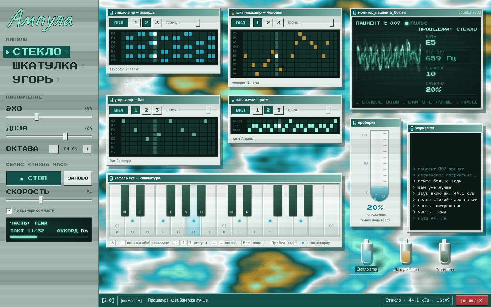

# Ампула: процедурный синтезатор водолечебницы

Веб-синтезатор по мотивам фильма «Лекарство от здоровья» (A Cure for Wellness, 2016). Звук здесь лечат водой: каждый инструмент хранится в своей ампуле, а пробирка «Погружение» опускает звук в бассейн санатория. Главное в синтезаторе — колыбельная «Тихий час»: она звучит от начала до конца, а поверх неё можно играть на клавишах.



Чистые HTML, CSS и JavaScript на Web Audio API, без библиотек и сборки.

## Как запустить

- Скачать репозиторий и открыть `index.html` в браузере (Chrome, Firefox, Safari, Edge).
- Или включить GitHub Pages: **Settings → Pages → Deploy from a branch → `main`, папка `/ (root)` → Save**. Через пару минут синтезатор откроется по ссылке вида `https://логин.github.io/репозиторий/`.

Звук включается после первого нажатия: браузеры не разрешают сайтам звучать сами.

## Структура

```
├── index.html            синтезатор
├── stylesheets/
│   └── style.css         оформление: окна, сетки нот, клавиши, пробирка
├── javascripts/
│   ├── engine.js         звук: инструменты, капли, огибающие, вода, эхо, лимитер
│   ├── interface.js      клавиши, ампулы, пробирка, ползунки, монитор, журнал
│   ├── composition.js    колыбельная «Тихий час»: мелодии, сценарий, пульт
│   └── desktop.js        окна и значки, которые можно двигать; запуск
└── images/
    ├── wallpaper.svg     обои рабочего стола
    ├── favicon.svg       значок вкладки
    ├── favicon.png       значок вкладки для старых браузеров
    └── screenshot.jpg    скриншот для этого описания
```

## Концепция

**Идея.** Синтезатор-водолечебница. Инструменты хранятся в ампулах, звук «лечат» погружением в воду: чем глубже, тем глуше, медленнее и тревожнее он звучит.

**Как работает.** Четыре инструмента играют вальс-колыбельную «Тихий час» по сетке нот, а человек дополняет её на клавишах-кафеле. Все звуки проходят через общий «бассейн»: фильтр воды, подводное покачивание высоты, эхо кафельного коридора и дозу.

**Что особенного.** Пробирка «Погружение». Одно движение меняет сразу три вещи: закрывает фильтр, раскачивает высоту и добавляет эха. В финале колыбельной вода поднимается сама, и звук уходит под воду, как герой фильма в капсуле.

**Стиль.** Рабочий стол старого компьютера санатория, 2003 год: окна инструментов, значки-ампулы, монитор пациента, журнал-терминал, панель задач. Цвета взяты из больничных интерьеров фильма: мятный кафель, мертвенно-бирюзовый и голубое «лекарство».

## Композиция «Тихий час»

Вальс 3/4, ля минор, 84 удара в минуту, аккорды Am – F – Dm – E – Am – F – E7 – Am. Сеанс идёт 32 такта (около минуты) и состоит из четырёх частей:

| Часть | Такты | Что звучит |
|---|---|---|
| Вступление | 1–8 | долгие аккорды Стекла, заводная Шкатулка, тихие капли |
| Тема | 9–16 | вальс: бас Угря на первую долю, аккорды на вторую и третью, тема Шкатулки |
| Развитие | 17–24 | переливы Стекла, вариация темы, бас с квинтой, дождь из капель |
| Финал | 25–32 | тема возвращается, Угорь ползёт, вода поднимается, звук засыпает на ля-миноре |

Без галочки «по сценарию» куплет из 8 тактов играет по кругу, а инструменты включаются и меняются вручную.

## Инструменты

| Окно | Роль | Как устроен звук | Мелодии |
|---|---|---|---|
| Стекло (AQUA) | аккорды | синус, синус на октаву выше и тихий треугольник; медленная атака, вибрато | долгие, вальс, переливы |
| Шкатулка (LULLABIA) | мелодия | синус с FM-модулятором, который даёт звон язычка; каждая нота чуть фальшивит | тема, вариация, заводная |
| Угорь (ANGUILLA) | бас | пила и квадрат через резонансный фильтр; нота «заползает» снизу | опора, с квинтой, ползёт |
| Капли | ритм | капля (короткий «плинк»), тик (капает кран), плюх (низкий удар) | тихий, вальс, дождь |

У каждого окна есть «вкл/выкл», три готовые мелодии, громкость и сетка нот на 8 тактов. Ноты можно менять: щелчок по клетке ставит или убирает ноту, можно провести по сетке.

Переходы плавные: новая мелодия начинается с начала следующего такта, а инструмент включается и выключается с затуханием, без обрыва нот.

## Управление

| Действие | Как |
|---|---|
| Начать сеанс | «▶ Старт» в пульте слева, «Ок» в окне «??????» или пробел |
| Начать с начала | «Заново» |
| Скорость | ползунок «Скорость», 60–120 ударов в минуту |
| Играть поверх музыки | мышью или пальцами по клавишам-кафелю; на клавиатуре ряд `A W S E D F T G Y H U J K O L P ; '` (в любой раскладке). Голубые точки на клавишах — ноты, которые подходят к текущему аккорду |
| Голос для клавиш | ампулы в меню слева, значки на рабочем столе или клавиши `1`, `2`, `3` |
| Октава клавиш | кнопки − и + или стрелки `←` `→` |
| Погружение | тянуть воду в пробирке вверх и вниз |
| Эхо коридора, доза | ползунки |
| Заглушить всё | `Esc` или красная кнопка «[тишина]» |
| Двигать окна и значки | тянуть окно за заголовок, значок — за него самого; «[по местам]» возвращает всё обратно |

## Путь звука

```
сетка нот / клавиша → инструмент: генераторы → фильтр → огибающая громкости
                    → дорожка инструмента (вкл/выкл, громкость)
                    → вода: фильтр погружения + подводное покачивание высоты
                    → эхо кафельного коридора (свёрточная реверберация)
                    → доза (громкость) → лимитер → монитор → колонки
```

Ноты ставятся в очередь звука заранее, с упреждением 0,12 секунды, поэтому ритм не плывёт, даже если страница занята.
