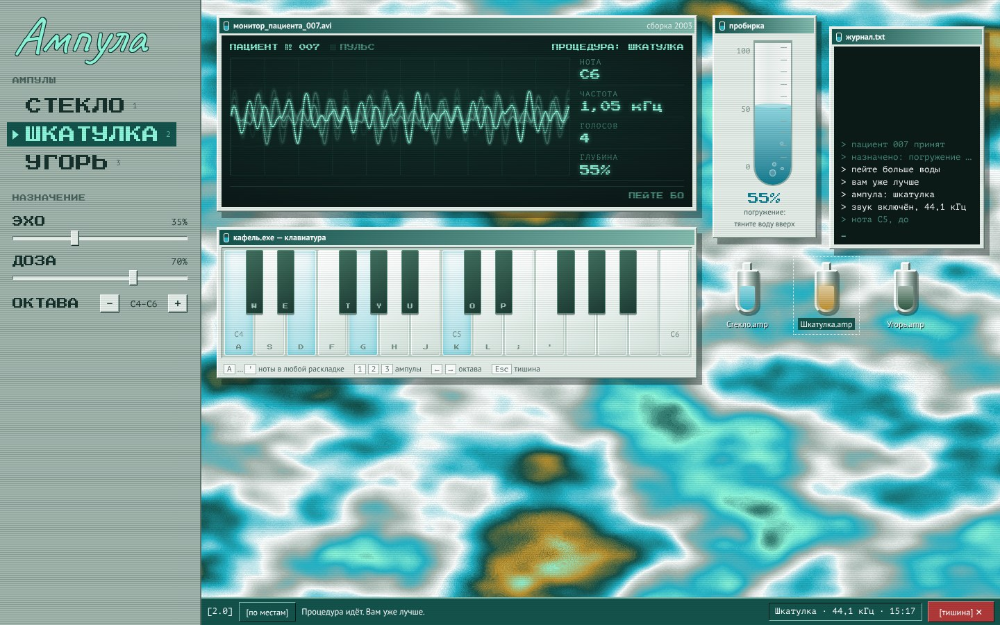

# Ампула: процедурный синтезатор водолечебницы

Веб-синтезатор начального уровня по мотивам фильма «Лекарство от здоровья» (A Cure for Wellness, 2016). Звук здесь лечат водой: каждый тембр хранится в своей ампуле, а пробирка «Погружение» опускает его в бассейн санатория. Чем глубже, тем глуше, медленнее и тревожнее он звучит.



Чистые HTML, CSS и JavaScript на Web Audio API, без библиотек и сборки.

## Как запустить

- Скачать репозиторий и открыть `index.html` в браузере (Chrome, Firefox, Safari, Edge).
- Или включить GitHub Pages: **Settings → Pages → Deploy from a branch → `main`, папка `/ (root)` → Save**. Через пару минут синтезатор откроется по ссылке вида `https://логин.github.io/репозиторий/`.

Звук включается после первого нажатия: браузеры не разрешают сайтам звучать сами.

## Структура

```
├── index.html          синтезатор
├── stylesheets/
│   └── style.css       оформление: окна, клавиши, пробирка, цвета и шрифты
├── javascripts/
│   ├── engine.js       звук: голоса, огибающие, вода, эхо, лимитер
│   ├── interface.js    клавиши, ампулы, пробирка, ползунки, монитор, журнал
│   └── desktop.js      окна и значки, которые можно двигать; запуск
└── images/
    ├── wallpaper.svg   обои рабочего стола
    ├── favicon.svg     значок вкладки
    ├── favicon.png     значок вкладки для старых браузеров
    └── screenshot.jpg  скриншот для этого описания
```

## Концепция

**Идея.** Синтезатор-водолечебница. Тембры хранятся в ампулах, звук «лечат» погружением в воду.

**Как работает.** Каждая клавиша запускает отдельный голос: генераторы, фильтр и огибающая громкости. Дальше общий «бассейн»: фильтр воды, подводное покачивание высоты, эхо кафельного коридора и доза.

**Что особенного.** Пробирка «Погружение». Одно движение меняет сразу три вещи: закрывает фильтр, раскачивает высоту и добавляет эха. Звук тонет, как герой фильма в капсуле. Вместо осциллографа здесь монитор пациента, вместо клавиш больничный кафель.

**Стиль.** Рабочий стол старого компьютера санатория, 2003 год: окна и значки-ампулы, которые можно перетаскивать, журнал-терминал, панель задач, пиксельные и рукописные шрифты, строки развёртки. Цвета взяты из больничных интерьеров фильма: мятный кафель, мертвенно-бирюзовый и голубое «лекарство».

## Управление

| Действие | Как |
|---|---|
| Играть ноты | мышью или пальцами по клавишам-кафелю; на клавиатуре ряд `A W S E D F T G Y H U J K O L P ; '` (в любой раскладке) |
| Выбрать ампулу | клик по ампуле или клавиши `1`, `2`, `3` |
| Октава | кнопки − и + или стрелки `←` `→` |
| Погружение | тянуть воду в пробирке вверх и вниз |
| Эхо коридора, доза | ползунки |
| Заглушить всё | `Esc` или красная кнопка «[тишина]» на панели задач |
| Двигать окна и значки | тянуть окно за заголовок, значок — за него самого; «[по местам]» на панели задач возвращает всё обратно |

## Голоса

| Ампула | Роль | Как устроен звук |
|---|---|---|
| Стекло (AQUA) | аккорды | синус, синус на октаву выше и тихий треугольник; медленная атака, лёгкое вибрато |
| Шкатулка (LULLABIA) | мелодия | синус с FM-модулятором, который даёт звон язычка; нота затухает сама; каждая нота чуть фальшивит, как старый механизм |
| Угорь (ANGUILLA) | бас | пила и квадрат октавой ниже через резонансный фильтр с огибающей; звучит на две октавы ниже клавиш, нота «заползает» снизу на два полутона |

Одновременно звучит до 12 нот. Голоса можно смешивать: сменить ампулу, пока звучит предыдущая.

## Путь звука

```
клавиша → голос: генераторы → фильтр → огибающая громкости
        → вода: фильтр погружения + подводное покачивание высоты
        → эхо кафельного коридора (свёрточная реверберация)
        → доза (громкость) → лимитер → монитор → колонки
```

Погружение от 0 до 100 % опускает срез фильтра с 16 кГц до 320 Гц, добавляет гулкий резонанс, раскачивает высоту до ±32 центов и прибавляет эха.

## Что попробовать за минуту

1. Нажать любую клавишу, чтобы монитор ожил.
2. Сыграть аккорд каждой ампулой: `1`, `2`, `3`.
3. Держать аккорд и медленно поднять воду в пробирке.
4. Покрутить «Эхо коридора» и сменить октаву стрелками.
